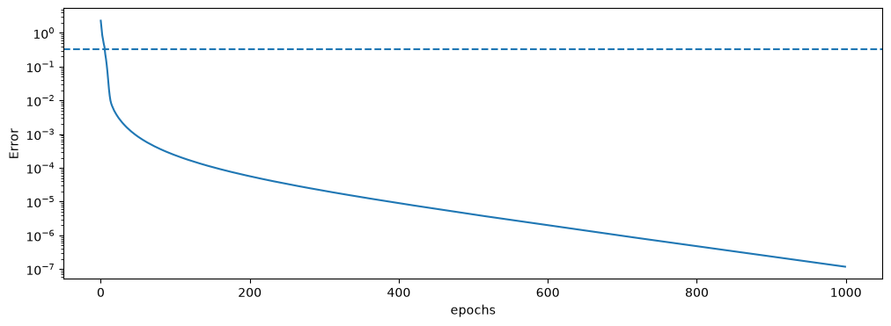
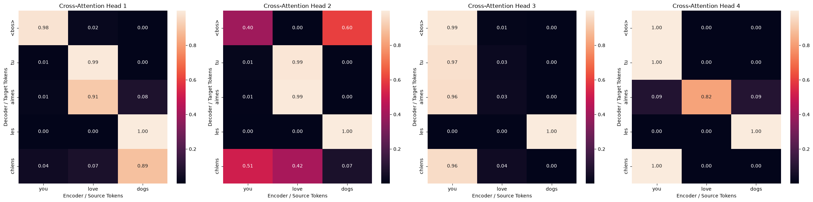

# Transformer from Scratch in NumPy

An encoder-decoder Transformer ("Attention Is All You Need") built **using only NumPy**: every layer has a hand-derived backward pass, verified against numerical gradients. It is trained on a tiny English → French translation task to show that the whole pipeline works end to end: tokenization, embeddings, attention, training, and greedy decoding.

> No PyTorch, TensorFlow or autograd. Every gradient in this repo is written by hand.

## Highlights

- Full encoder-decoder architecture: multi-head self-attention, masked self-attention, cross-attention, residual connections, LayerNorm, feed-forward blocks
- Manual backpropagation through every layer, including the gradient that flows from the decoder back into the encoder through cross-attention
- Gradient checking (central finite differences) on weights and embeddings across the whole depth of the model
- Adam optimizer implemented from scratch
- Greedy autoregressive inference with a causal mask that grows at each step
- Evaluation on **held-out word combinations** the model never saw in training

## Architecture

```
Source tokens                         Target tokens (shifted right)
     |                                          |
 Embedding + Positional Encoding        Embedding + Positional Encoding
     |                                          |
 +--------------------+                +-----------------------------+
 | Multi-Head Self-   |                | Masked Multi-Head Self-Attn |
 | Attention          |                | Add & Norm                  |
 | Add & Norm         |    memory      | Multi-Head Cross-Attention  |
 | Feed-Forward       | -------------> |   (Q: decoder, K,V: memory) |
 | Add & Norm         |                | Add & Norm                  |
 +--------------------+                | Feed-Forward                |
      Encoder (x1)                     | Add & Norm                  |
                                       +-----------------------------+
                                                Decoder (x1)
                                                    |
                                          Linear -> Softmax -> next token
```

| Setting | Value |
|---|---|
| Model dimension `d_model` | 16 |
| Attention heads | 4 (`d_k = 4`) |
| Feed-forward hidden units | 64 (ReLU) |
| Layers | 1 encoder, 1 decoder |
| Positional encoding | Fixed sinusoidal |
| Normalization | LayerNorm with learnable `gamma`, `beta` |
| Loss | Cross-entropy (teacher forcing) |
| Optimizer | Adam (`lr=0.01`, `beta1=0.9`, `beta2=0.999`) |
| Training | 1000 epochs, one sentence pair per update, shuffled each epoch |
| Seed | 40 |

## Implemented components

Each component is a class holding its own parameters, caching what its backward pass needs.

| Component | Forward | Backward |
|---|---|---|
| `MultiHead` | Q/K/V projections, scaled dot-product attention per head, optional additive mask, concat, output projection | Per-head softmax backward, gradients for all four weight matrices, and separate input gradients `dq_in`, `dk_in`, `dv_in` |
| `AddNorm` | Residual add, LayerNorm, `gamma`/`beta` | Closed-form LayerNorm gradient, `dgamma`, `dbeta` |
| `Dense` (feed-forward) | Linear, ReLU, Linear | Matmul rule, ReLU mask, bias gradients summed over tokens |
| `Linear` + `SoftmaxCrossEntropy` | Logits, stable softmax | Combined `(p - onehot) / N` gradient |
| `Adam` | Bias-corrected first and second moment estimates | In-place parameter updates |

### How gradients are wired

The same two rules explain the whole backward pass:

1. **A tensor used in several places receives the sum of its gradients.** For example, the encoder input `X` feeds Q, K, V and the residual connection, so `dX = dr + dq_in + dk_in + dv_in`.
2. **Concatenation is undone by slicing.** The gradient of the concatenated heads is split back into per-head slices.

The decoder's cross-attention is where the two halves of the model connect: `dq_in` continues down the decoder, while `dk_in + dv_in` becomes the gradient entering the top of the encoder. Positional encodings are constants, so the gradient flows straight into the embedding tables with `np.add.at`.

## Dataset

A small synthetic grid: 2 subjects x 2 verbs x 4 objects.

```
i / you   x   love / see   x   cats / dogs / birds / fish
```

- **Train:** 13 sentence pairs (e.g. `i love cats -> j' aime les chats`, `you see dogs -> tu vois les chiens`)
- **Held-out test:** 3 pairs, **never seen as a combination**: `you love dogs`, `you love birds`, `you love fish`. In training, `you love` appears only with `cats`, so these test whether the model combines known pieces rather than recalling sentences.

Word-level vocabularies are built separately for each language, with `<bos>` and `<eos>` added to the target side.

## Results

| Metric | Value |
|---|---|
| Final training loss | 1.1850903024266805e-07 |
| Training accuracy (exact match) | 1.0 |
| Held-out accuracy (exact match) | 1.0 |
| Held-out per-word accuracy | 1.0 |

## Seed and Generalization

| Seed | Final training loss | Training accuracy | Held-out accuracy |Held-out per-word accuracy |
|---|---|---|---|---|
|30|1.0180949759854833e-07|1.0|1.0|1.0/1.0/1.0|
|101|1.2886357631725477e-07|1.0|0.666|1.0/1.0/0.5|
|50|1.0752528592959241e-07|1.0|1.0|1.0/1.0/1.0|
|42|1.1045874643534732e-07|1.0|1.0|1.0/1.0/1.0|

## Assets
**Training Loss**



**Cross-Attention  Heatmap**



## Findings

**1. A loss plateau shows when the model ignores the source.** With teacher forcing, the decoder can predict many tokens from the previous target words alone. For this dataset, the best possible predictor that never looks at the source reaches an average loss of about **0.51**. A model whose loss stalls near that value has not learned to use the encoder; a loss that falls well below it has. Plain SGD stalled there, and Adam passed through it.

**2. Gradient checks catch what unit tests would miss.** Each layer passed its own check, and a whole-model check confirmed the wiring between them. Weights deep in the encoder only receive gradient through the full decoder, so that check validates the cross-attention junction.

**3. Models this small can learn shortcuts.** In an earlier, smaller configuration, one attention head attended to the object word while predicting the verb, a shortcut that fit the training pairs but failed on a held-out one. Adding more object words made the shortcut more expensive and fixed it.

**4. Results depend on the seed at this scale.** Compare several seeds before concluding that a change helped.

## Gradient checking

For a parameter entry `w`, the analytic gradient is compared with `(L(w + e) - L(w - e)) / 2e`, using the same forward pass and no backward code. The notebook checks the encoder embedding, an encoder attention weight, and the decoder embedding; typical maximum differences are in the range 1e-10 to 1e-6.

## Limitations

- Toy dataset (13 training pairs, 3 held-out); this demonstrates correctness, not translation quality
- One encoder and one decoder layer, batch size 1 (no padding masks)
- Word-level vocabulary with no unknown-token handling
- Greedy decoding only (no beam search)
- The training loop assumes target sentences have the same length

## Run it

```bash
pip install numpy matplotlib seaborn
jupyter notebook implementing_transformer_in_numpy.ipynb
```

Run the cells from top to bottom. With `np.random.seed(40)` the run is reproducible.

## Possible extensions

- Stack N layers (the decoder's cross-attention gradients then accumulate across layers)
- Mini-batches with padding and padding masks
- Held-out loss tracking and early stopping
- Learning-rate warmup and decay
- A KV cache for faster inference
- A decoder-only character-level language model built from the same blocks

## Reference

Vaswani et al., *Attention Is All You Need* (2017).
